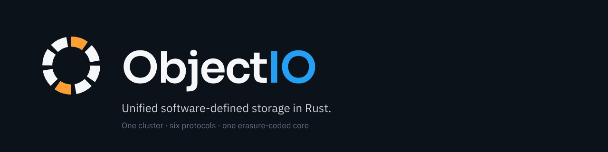

<p align="center"></p>

# ObjectIO

**Software-defined storage in Rust:** an S3-compatible object store on an
erasure-coded, topology-aware storage core, with data-lake catalogs and
block volumes built on the same core.

**0.1 is the first public release, and an early one.** S3 and the storage
core have been through a 48-hour soak under faults, a multi-host chaos suite
and the ceph s3-tests; the data lake APIs and block are previews, and file is
planned. Admin API and CLI details may still change between 0.x releases;
an upgrade from one release to the next, one node at a time, is supported
from the start. What exists is listed feature by feature in
**[features](https://object-io.github.io/latest/features/)**, what comes next
in the **[roadmap](https://object-io.github.io/latest/ROADMAP/)**; the full
documentation is at **[object-io.github.io](https://object-io.github.io)**.

## Where it stands

| Area | State |
|---|---|
| **S3** | The most complete part, and the one being made production-ready first: core operations, multipart, versioning, Object Lock, lifecycle, policies, SSE-S3/KMS/C, CORS, presigned and POST uploads, STS, tenancy, audit, bucket logging, bucket replication. Checked against the [ceph s3-tests](https://object-io.github.io/latest/developer-guide/s3-compatibility/) suite on every run. |
| **Storage core** | Erasure coding (Reed-Solomon 4+2 by default; ISA-L on x86), placement groups across failure domains, repair, drain, small-object packing, a Raft metadata service that survives losing a node. Rolling upgrades from one release to the next. |
| **Data lake** | Iceberg REST Catalog, Unity Catalog API and Delta Sharing are built, but not yet tested end to end against real engines (Spark, Trino, PyIceberg): a preview. |
| **Block** | Volumes over NBD and gRPC with snapshots, clones and thin provisioning. QoS is not enforced, and iSCSI/NVMe-oF are not built yet: a preview. |
| **File** | Planned. |

## Quickstart

The all-in-one binary runs meta, an OSD and the gateway in one process,
for a laptop, a demo or a smoke test (not for production):

```sh
VERSION=v0.1.0-rc.1
OS=$(uname -s | tr '[:upper:]' '[:lower:]')            # linux | darwin
ARCH=$(uname -m | sed 's/x86_64/amd64/; s/aarch64/arm64/')
curl -L -o objectio-aio \
  "https://github.com/object-io/objectio/releases/download/${VERSION}/objectio-aio-${VERSION}-${OS}-${ARCH}"
chmod +x objectio-aio
./objectio-aio --data ~/objectio-data
```

Release binaries exist for `linux-amd64`, `linux-arm64` and
`darwin-arm64`. On start it prints the S3 endpoint
(`http://localhost:9000`), the console (`/_console/`) and the admin
access key. Then:

```sh
aws --endpoint-url http://localhost:9000 s3 mb s3://my-bucket
aws --endpoint-url http://localhost:9000 s3 cp file.txt s3://my-bucket/
```

For a cluster, use the Helm chart and the image
`ghcr.io/object-io/objectio:<tag>`:

```sh
helm install objectio oci://ghcr.io/object-io/charts/objectio --version 0.1.0-rc.1 -f values.yaml
```

Installation, administration and the APIs are covered in the
[documentation](https://object-io.github.io).

## Agent skills

Skills that teach a coding agent (Claude Code, Codex, opencode, …) to
deploy and run ObjectIO (`objectio-ops`) and to build on its APIs
(`objectio-dev`). `obioctl` carries them:

```sh
obioctl skills install
```

or, in Claude Code, from this repository:

```
/plugin install objectio-ops --marketplace object-io/objectio
/plugin install objectio-dev --marketplace object-io/objectio
```

What each covers: [skills/README.md](skills/README.md).

## Building from source

```sh
# macOS
brew install nasm autoconf automake libtool llvm protobuf
# Ubuntu / Debian
sudo apt-get install build-essential nasm autoconf automake libtool libclang-dev protobuf-compiler

make build            # debug build, with ISA-L (x86_64); on ARM: cargo build --workspace
make test             # all tests (tests/e2e runs real clusters of processes)
```

## Contributing

Bug reports, fixes and features are welcome: start with
[CONTRIBUTING.md](CONTRIBUTING.md). Security problems are reported
privately ([SECURITY.md](SECURITY.md)).

## License

[Apache License 2.0](./LICENSE). Everything is open source: no license
keys, tiers or usage caps.
